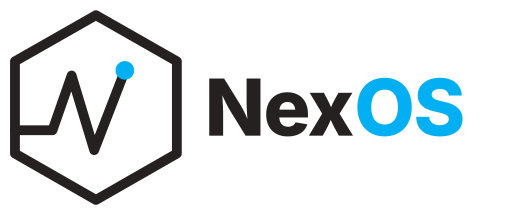
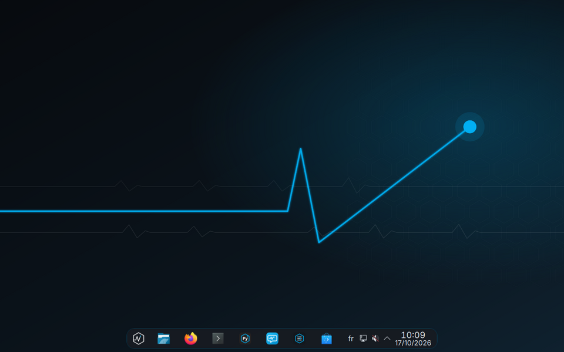
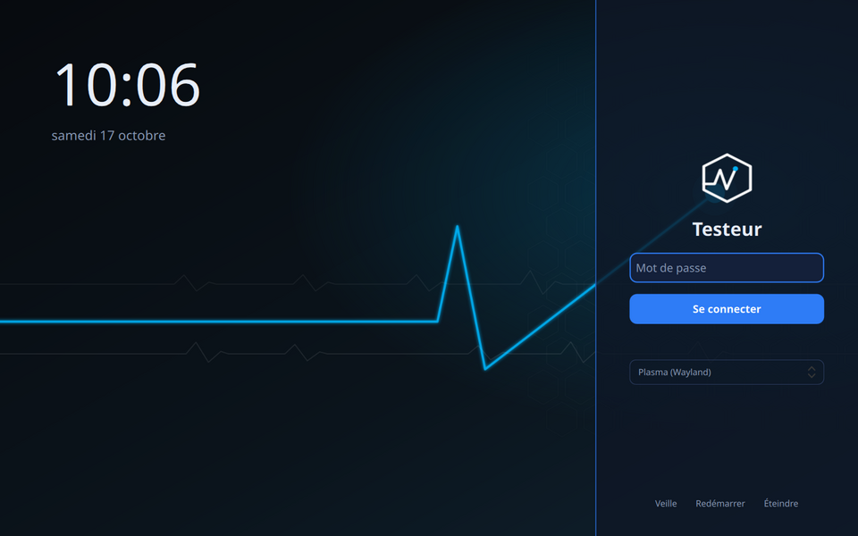
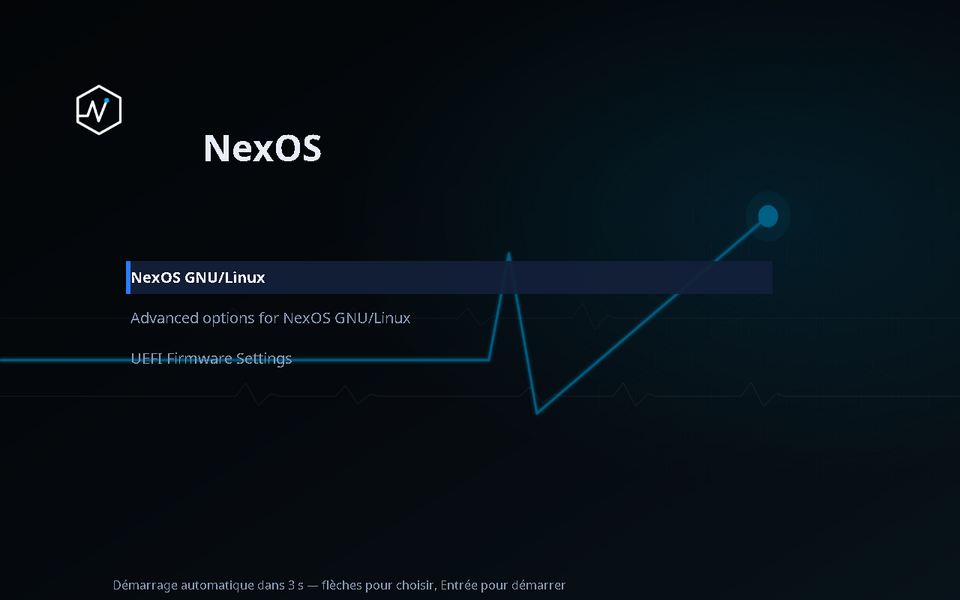
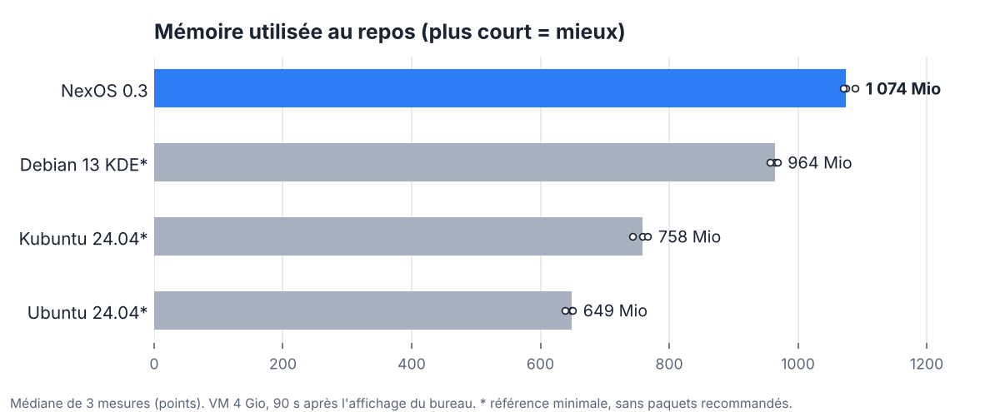
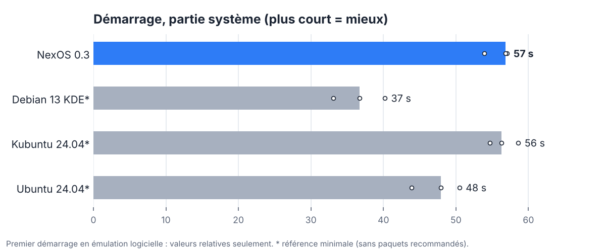

  <picture>
    <source media="(prefers-color-scheme: dark)" srcset="docs/assets/logo-dark.png">
    
  </picture>

<h3 align="center">Le poste de travail Linux pour créer : électronique, code, sciences et IA locale. Prêt à l'emploi, en français et en arabe.</h3>

  <b>Prototype 0.3</b> · basé sur Debian 13 « trixie » · bureau KDE Plasma 6 (Wayland) · licence libre
   <a href="README.md">English version</a>

  

---

## Pourquoi NexOS ?

Sur Ubuntu, Kubuntu ou Debian, transformer un PC neuf en atelier d'électronique et de développement
prend des heures : trouver les bons paquets, les bonnes bibliothèques Arduino, configurer KiCad, LaTeX,
Python, régler les droits du port série… **NexOS arrive déjà prêt**, et chaque outil intégré a été
**réellement testé** dans l'image (les preuves sont dans ce dépôt).

| | Ce que NexOS apporte d'origine | Vérifié |
|---|---|---|
| 🔌 **Électronique** | Arduino IDE + **Centre Arduino** : catalogue de **100 bibliothèques** en 20 catégories (version, licence, dépendances, maintenance), installation/mise à jour/suppression en un clic, diagnostic des cartes et du port série | **82 bibliothèques compilées** hors ligne, 0 échec, 18 réservées à d'autres cartes ([détail](docs/ARDUINO_LIBRARIES.md)) |
| 🛠️ **Conception de cartes** | KiCad 9 avec bibliothèques de symboles, empreintes et modèles | ERC, DRC, export PDF, netlist, **22 fichiers Gerber/perçage**, rendu 3D, schéma → PCB |
| 📄 **Rédaction scientifique** | TeX Live (français, arabe, sciences), TeXmaker, Biber, police Amiri | rapport avec maths, images, tableau, bibliographie ; document **arabe** (XeLaTeX) |
| 🐍 **Python** | **Centre Python** : 8 environnements prêts (base, science, IA, vision, électronique, applications, analyse de données, qualité du code), versions figées | tous les tests de chaque profil passent |
| 🤖 **Assistant IA local** | modèle Qwen 2.5 qui tourne **sur votre PC, hors ligne**, chargé seulement quand on l'utilise, déchargé après | 20/24 tâches réussies ; ≈1,3 Go de RAM au plus ; ≈10 jetons/s sur processeur |
| ↩️ **Retour arrière** | instantanés Btrfs automatiques avant/après chaque mise à jour, bouton « Revenir à un instantané » | suppression d'un logiciel puis **restauration réelle** (159 fichiers) sur un système installé |
| 🎛️ **Control Center** | démarrage, services, réseau, mises à jour, pare-feu, sauvegardes, composants optionnels — actions administrateur confirmées | tests automatisés |
| 🌍 **Langues** | français par défaut, arabe (claviers fr + ar, Alt+Maj), documents arabes | |
| 🪶 **Sobriété** | rien de lourd au démarrage : audit automatique des services à chaque construction, pas d'indexation de fichiers ni de notificateur résident par défaut | audit « conforme » |

  
  

Écran de connexion et menu de démarrage NexOS, capturés sur un système réellement installé (machine virtuelle UEFI).

---

## Comparaison mesurée

Nous avons mesuré NexOS face à trois systèmes, **avec le même banc** : même machine virtuelle
(4 Gio de RAM, 4 processeurs), démarrage puis **90 s de repos après l'affichage du bureau**, 3 mesures
par système, capture d'écran de preuve à chaque fois. Méthode complète et limites :
[docs/COMPARISON.md](docs/COMPARISON.md).

  <picture>
    <source media="(prefers-color-scheme: dark)" srcset="docs/assets/comparaison-memoire-dark.png">
    
  </picture>

  <picture>
    <source media="(prefers-color-scheme: dark)" srcset="docs/assets/comparaison-demarrage-dark.png">
    
  </picture>

| Médiane de 3 mesures | NexOS 0.3 | Debian 13 KDE* | Kubuntu 24.04* | Ubuntu 24.04* |
|---|---|---|---|---|
| Bureau | Plasma 6, Wayland | Plasma 6, Wayland | Plasma 5, X11 | GNOME 46, Wayland |
| Mémoire au repos | 1 074 Mio | 964 Mio | 758 Mio | 649 Mio |
| Démarrage (partie système) | 57 s | 37 s | 56 s | 48 s |
| Outils électronique / KiCad / LaTeX / IA / Python intégrés | **oui, testés** | non | non | non |

**Lecture honnête de ces chiffres :**
- \* Les trois systèmes de comparaison ont été construits **sans leurs paquets recommandés**
  (version minimale, sans l'application de bienvenue, la synchronisation de téléphone, le notificateur
  de mises à jour, la messagerie…). Ils sont donc **plus légers ici qu'une installation réelle**.
  Une première mesure des installations complètes a été faussée (écran mis en veille et
  verrouillé pendant la mesure) : elle sera refaite.
- À l'heure actuelle, **NexOS n'est pas le plus léger** : il embarque bien plus d'outils, le portail de
  bureau (partage d'écran, applications Flatpak) et un pare-feu actif, que les références minimales n'ont pas.
- Tout tourne en **émulation logicielle** (pas de vrai PC) : les durées ne valent qu'en comparaison.
- **Windows et Fedora ne sont pas mesurés** (images non téléchargeables depuis l'environnement de
  construction). Pour comparer sur votre propre PC : [tests/perf/real-hw/](tests/perf/real-hw/).

---

## État du projet

NexOS est un **prototype**. Ce qui est vérifié, et ce qui ne l'est pas encore :

| ✅ Vérifié (machine virtuelle) | ⚠️ Pas encore |
|---|---|
| ISO live + installateur graphique (Calamares), installation UEFI sur Btrfs, redémarrage | test sur PC réel |
| Écran de connexion, menu de démarrage, bureau NexOS | |
| Instantanés + retour arrière | AppArmor absent de l'image 0.3 : à réintégrer |
| Arduino, KiCad, LaTeX, Java, Python, assistant IA | construction d'un projet Android (Gradle) et MiKTeX : non testables ici |
| | ISO non signée (Secure Boot à désactiver pour démarrer la clé) |

## Essayer

- **Construire l'ISO** : [docs/INSTALL.md](docs/INSTALL.md) (Debian/Ubuntu, `mmdebstrap`, ~30 min).
- **Dans une machine virtuelle** : EFI activé, Secure Boot désactivé, 4 Go de RAM, 2 processeurs ou plus.
  Fonctionne avec QEMU/virt-manager (nos tests) et VirtualBox (retour utilisateur).
- **Récupération en cas de problème** : [docs/RECOVERY.md](docs/RECOVERY.md).

## Documentation

[Architecture](docs/ARCHITECTURE.md) · [Feuille de route](docs/ROADMAP.md) ·
[Comparaison](docs/COMPARISON.md) · [Mesures](docs/MEASUREMENTS.md) · [Bibliothèques Arduino](docs/ARDUINO_LIBRARIES.md) ·
[Matériel](docs/HARDWARE.md) · [Assistant IA](docs/AI_ASSISTANT.md) · [Centre Python](docs/PYTHON_CENTER.md) ·
[Bureau](docs/DESKTOP.md) · [Récupération](docs/RECOVERY.md)

NexOS repose sur Debian, KDE Plasma et de nombreux logiciels libres ; chacun reste sous sa propre licence (voir docs/DEPENDENCIES.md).
