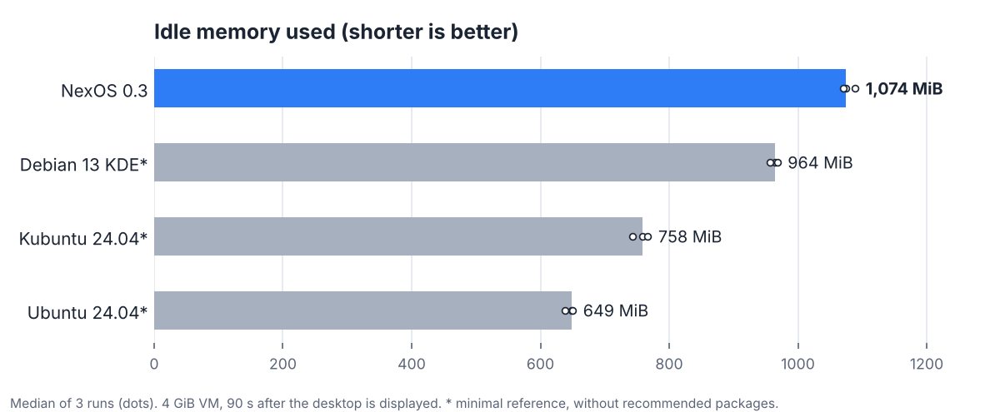
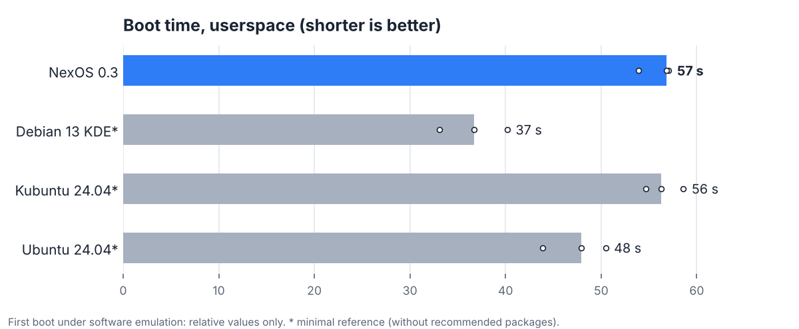

  <picture>
    <source media="(prefers-color-scheme: dark)" srcset="docs/assets/logo-dark.png">
    
  </picture>

<h3 align="center">The Linux workstation for makers: electronics, code, science and local AI. Ready out of the box, in French and Arabic.</h3>

  <b>Prototype 0.3</b> · based on Debian 13 "trixie" · KDE Plasma 6 desktop (Wayland) · free software
   <a href="README.fr.md">Version française</a>

  

---

## Why NexOS?

On Ubuntu, Kubuntu or Debian, turning a new PC into an electronics and development workshop takes hours:
finding the right packages and Arduino libraries, setting up KiCad, LaTeX and Python, fixing serial-port
permissions… **NexOS comes ready**, and every bundled tool has been **actually tested** inside the image
(the evidence is in this repository).

| | What NexOS ships out of the box | Verified |
|---|---|---|
| 🔌 **Electronics** | Arduino IDE + **Arduino Center**: catalogue of **100 libraries** in 20 categories (version, license, dependencies, maintenance status), one-click install/update/remove, board and serial-port diagnostics | **82 libraries compiled** offline, 0 failures, 18 reserved for other boards ([details](docs/ARDUINO_LIBRARIES.md)) |
| 🛠️ **PCB design** | KiCad 9 with symbol, footprint and template libraries | ERC, DRC, PDF export, netlist, **22 Gerber/drill files**, 3D render, schematic → PCB |
| 📄 **Scientific writing** | TeX Live (French, Arabic, science), TeXmaker, Biber, Amiri font | report with maths, images, table and bibliography; **Arabic** document (XeLaTeX) |
| 🐍 **Python** | **Python Center**: 8 ready-made environments (base, science, AI, vision, electronics, app development, data analysis, code quality) with pinned versions | every profile's test suite passes |
| 🤖 **Local AI assistant** | Qwen 2.5 model running **on your PC, offline**, loaded only when used and unloaded afterwards | 20/24 tasks passed; ≈1.3 GB RAM peak useage; ≈10 tokens/s on CPU |
| ↩️ **Rollback** | automatic Btrfs snapshots before/after every update, "Revert to a snapshot" button | removing an app then a **real restore** (159 files) on an installed system |
| 🎛️ **Control Center** | startup, services, network, updates, firewall, backups, optional components — admin actions require confirmation | automated tests |
| 🌍 **Languages** | French by default, Arabic (fr + ar keyboard layouts, Alt+Shift), Arabic documents | |
| 🪶 **Lean by design** | nothing heavy at startup: services are audited automatically at every build; no file indexer or resident update notifier by default | audit "compliant" |

  
  

NexOS login screen and boot menu, captured on a really installed system (UEFI virtual machine).

---

## Measured comparison

We measured NexOS against three systems **on the same test bench**: same virtual machine (4 GiB RAM,
4 CPUs), boot, then **90 s of idle after the desktop is displayed**, 3 runs per system, with a proof
screenshot every time. Full method and limits: [docs/COMPARISON.md](docs/COMPARISON.md) (French).

  <picture>
    <source media="(prefers-color-scheme: dark)" srcset="docs/assets/comparaison-memoire-en-dark.png">
    
  </picture>

  <picture>
    <source media="(prefers-color-scheme: dark)" srcset="docs/assets/comparaison-demarrage-en-dark.png">
    
  </picture>

| Median of 3 runs | NexOS 0.3 | Debian 13 KDE* | Kubuntu 24.04* | Ubuntu 24.04* |
|---|---|---|---|---|
| Desktop | Plasma 6, Wayland | Plasma 6, Wayland | Plasma 5, X11 | GNOME 46, Wayland |
| Idle memory | 1,074 MiB | 964 MiB | 758 MiB | 649 MiB |
| Boot (userspace) | 57 s | 37 s | 56 s | 48 s |
| Electronics / KiCad / LaTeX / AI / Python built in | **yes, tested** | no | no | no |

**How to read these numbers honestly:**
- \* The three reference systems were built **without their recommended packages** (a minimal
  variant: no welcome app, phone sync, update notifier, mail server…). They are therefore **lighter
  here than a real installation**. A first attempt with full installations was invalid (the screen
  went to sleep and locked during the measurement) and will be redone.
- **Today NexOS is not the lightest system**: it ships far more tools, the desktop portal (screen
  sharing, Flatpak apps) and an active firewall, which the minimal references do not have.
- Everything runs under **software emulation** (no real PC): timings are only meaningful relative to each other.
- **Windows and Fedora were not measured** (their images could not be downloaded from the build
  environment). To compare on your own PC: [tests/perf/real-hw/](tests/perf/real-hw/).

---

## Project status

NexOS is a **prototype**. What is verified, and what is not yet:

| ✅ Verified (virtual machine) | ⚠️ Not yet |
|---|---|
| Live ISO + graphical installer (Calamares), UEFI install on Btrfs, reboot | testing on real hardware |
| Login screen, boot menu, NexOS desktop | |
| Snapshots + rollback | AppArmor missing from the 0.3 image: to be restored |
| Arduino, KiCad, LaTeX, Java, Python, AI assistant | Android project build (Gradle) and MiKTeX: not testable in the build environment |
| | Unsigned ISO (disable Secure Boot to boot the USB stick) |

## Try it

- **Build the ISO**: [docs/INSTALL.md](docs/INSTALL.md) (Debian/Ubuntu host, `mmdebstrap`, ~30 min).
- **In a virtual machine**: EFI on, Secure Boot off, 4 GB RAM, 2+ CPUs. Works with QEMU/virt-manager (our tests) and VirtualBox (user report).
- **If something goes wrong**: [docs/RECOVERY.md](docs/RECOVERY.md).

## Documentation (French)

[Architecture](docs/ARCHITECTURE.md) · [Roadmap](docs/ROADMAP.md) ·
[Comparison](docs/COMPARISON.md) · [Measurements](docs/MEASUREMENTS.md) · [Arduino libraries](docs/ARDUINO_LIBRARIES.md) ·
[Hardware](docs/HARDWARE.md) · [AI assistant](docs/AI_ASSISTANT.md) · [Python Center](docs/PYTHON_CENTER.md) ·
[Desktop](docs/DESKTOP.md) · [Recovery](docs/RECOVERY.md)

NexOS code is licensed under **GPL-3.0-or-later** ([LICENSE](LICENSE)). It is built on Debian, KDE Plasma and many other free-software projects; each keeps its own license ([NOTICE](NOTICE.md)).
